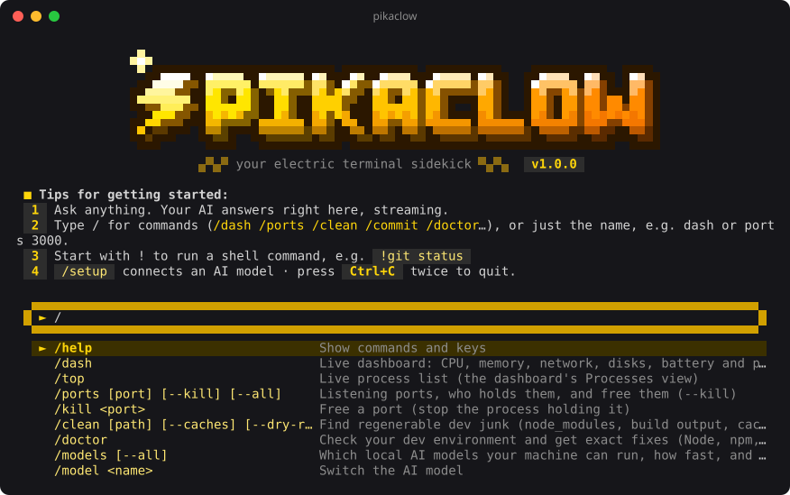
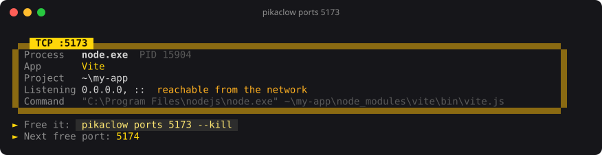
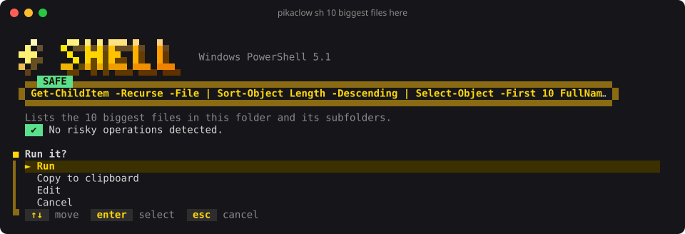
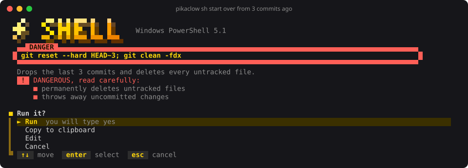
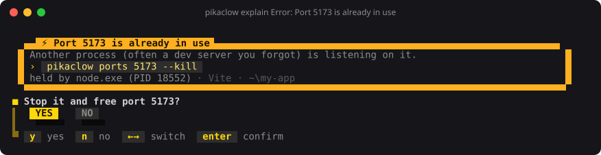
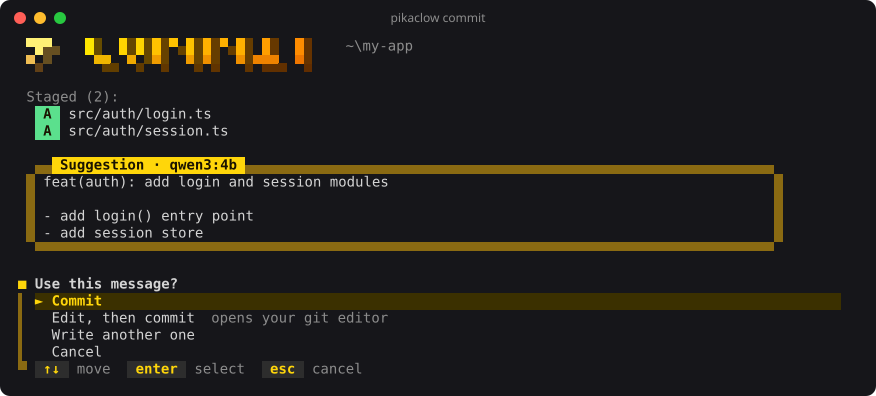
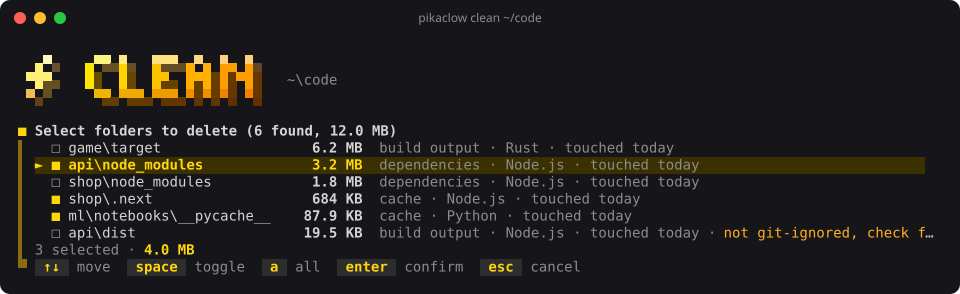
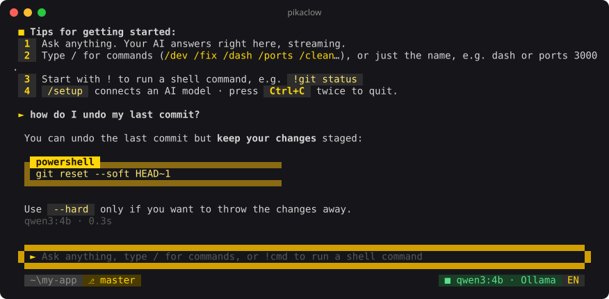
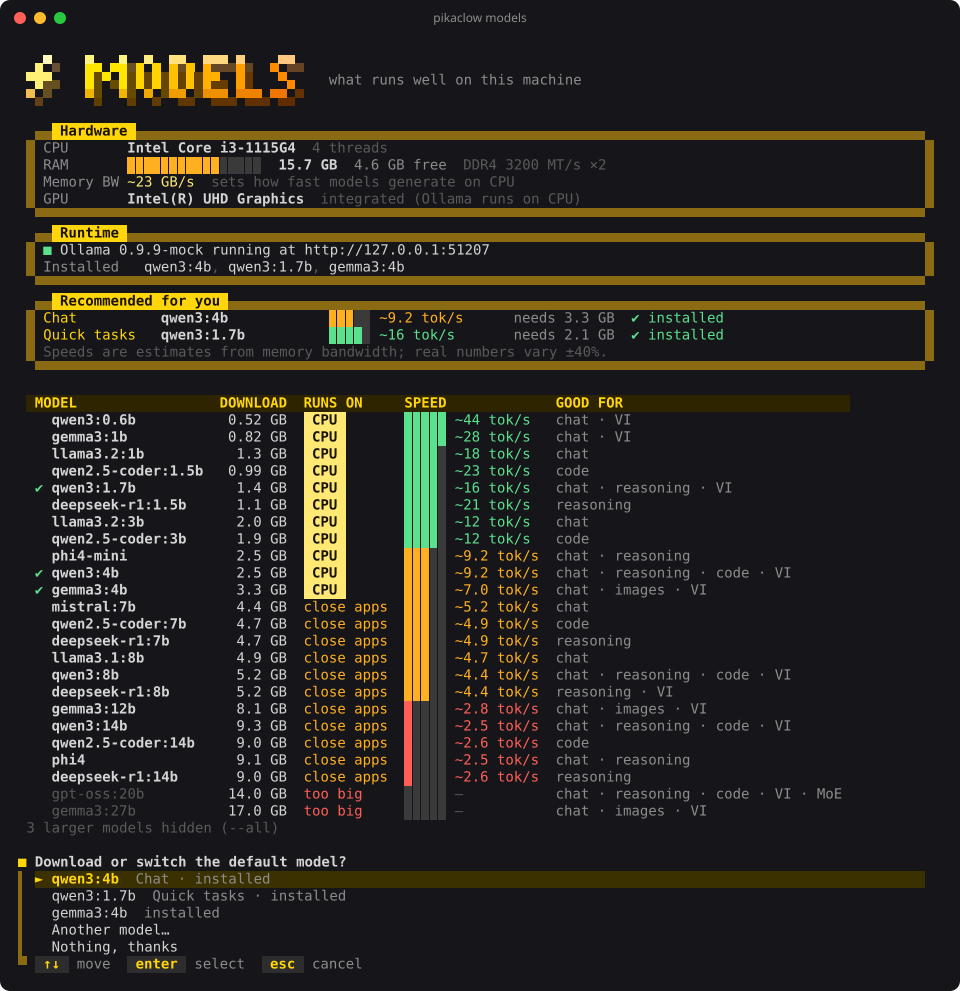

<p align="center">
  
</p>

<h1 align="center">PikaClow ⚡</h1>

<p align="center">
  <b>Your electric terminal sidekick.</b><br>
  A light system dashboard, a port finder that frees ports, a dev-junk cleaner that cannot touch your source,
  an environment doctor, and local-AI helpers that write commit messages, turn plain words into shell commands
  and explain errors. Private by default, works offline, built Windows-first.
</p>

<p align="center">
  <a href="https://www.npmjs.com/package/pikaclow"></a>
  
  
  
</p>

<p align="center"><a href="README.vi.md">Đọc bằng Tiếng Việt</a></p>

---

## Install

```bash
npm install -g pikaclow
pikaclow
```

Needs Node.js 20 or newer. The AI features are optional: they work with [Ollama](https://ollama.com) on your own
machine, or any OpenAI-compatible API (LM Studio, OpenRouter, Groq, Gemini, OpenAI…). Run `pikaclow setup` to connect one.

## What makes it different

- **Pixel art all the way.** The logo, section titles, frames, meters, menus, buttons and status bar are drawn as
  crisp pixel art with half-block characters, in a warm Pikachu-yellow palette (with fallbacks for old consoles,
  light themes and plain ASCII).
- **Interactive home.** Run `pikaclow` with no arguments: a Gemini-style prompt with a `/` command menu, history,
  `!cmd` to run shell commands, and a streaming AI chat that knows your OS, shell, folder and git branch.
- **Knows who holds your port.** `pikaclow ports 3000` tells you it is *Vite from `~/work/shop`*, not just `node.exe`,
  shows whether it is exposed to your Wi-Fi, suggests the next free port, and frees it with `--kill`.
- **Explains errors, then fixes them.** `pikaclow explain -- npm run dev` runs your command; when it fails with
  `EADDRINUSE`, it offers to stop the process holding the port and rerun. 25+ common errors are recognized offline
  (PowerShell execution policy, missing modules, heap out of memory, ERESOLVE, SSH keys…), then AI digs deeper.
- **Shell commands from plain words, checked by code.** `pikaclow sh "10 biggest files here"` writes the command for
  *your* shell (PowerShell, cmd, bash, zsh, fish). A built-in checker, not the AI, flags dangerous parts
  (`rm -rf`, `git reset --hard`, `curl | sh`, `setx PATH`…) and makes you type `yes` before running them.
- **A cleaner that cannot delete your source.** Only regenerable folders are offered (`node_modules`, `.next`,
  `target`, `__pycache__`, `bin/obj`…) and only next to their project marker (`package.json`, `Cargo.toml`,
  `*.csproj`…). `dist`/`build`/`out` are pre-selected only when git confirms they are ignored.
- **Honest model advice.** `pikaclow models` measures your memory bandwidth and estimates **tokens per second** for
  each model, so a laptop gets a model that actually feels fast, not the biggest one that barely fits.
- **Commit messages even offline.** `pikaclow commit` uses AI when available and a file-based Conventional Commit
  generator when not. English or Vietnamese.
- **Light on your machine.** The dashboard reuses one PowerShell helper on Windows instead of spawning a process
  per sample, never overlaps polls, and shows its own CPU/RAM in the footer (typically ~1–2%).
- **English and Vietnamese**, auto-detected, switchable with `--lang` or `/lang`.

## Commands

| Command | What it does |
| --- | --- |
| `pikaclow` | Interactive mode (prompt, `/` menu, `!shell`, AI chat) |
| `pikaclow dash` · `top` | Live dashboard: CPU, memory, network, disks, battery, processes (sort, group, filter, kill) |
| `pikaclow ports [port]` | Listening ports with app/project detection · `--kill` · `--pick` · `--all` · `--json` |
| `pikaclow clean [path]` | Find and delete regenerable dev folders · `--dry-run` · `--caches` for npm/pnpm/yarn/pip caches |
| `pikaclow doctor` | Check Node, npm, git, PATH, disk, PowerShell policy, long paths, AI… with exact fixes |
| `pikaclow ask "…"` | Ask the AI; pipe text in for context: `cat log.txt \| pikaclow ask "why?"` |
| `pikaclow sh "…"` | Plain words → shell command, risk-checked, then run / copy / edit |
| `pikaclow explain` | `explain -- <cmd>`, `cmd 2>&1 \| pikaclow explain`, or `explain "error text"` |
| `pikaclow commit` | AI (or offline) commit message for staged changes · `--all` · `--yes` · `--dry-run` · `--msg-lang vi` |
| `pikaclow models` | Which local models run well here, how fast, download and switch · `--pull <model>` |
| `pikaclow setup` | Language, AI provider and model, commit language |

Every command has `--help`. Global flags: `--lang en|vi`, `--ascii`, `--no-color`.

### Ports



### Shell commands from plain words




### Explain an error



### Commit



### Clean



### AI chat in interactive mode



### Model advisor



## AI setup

**Local and private (recommended):** install [Ollama](https://ollama.com/download), then run `pikaclow models`,
pick a suggested model and PikaClow downloads it and makes it the default.

**Any OpenAI-compatible API:** `pikaclow setup` → *An OpenAI-compatible API* → choose LM Studio, OpenRouter, Groq,
Gemini, OpenAI, DeepSeek or a custom URL. The key can be read from an environment variable (recommended) or stored
in the config file.

Environment variables override the config: `PIKACLOW_PROVIDER` (`ollama` | `openai`), `PIKACLOW_MODEL`,
`PIKACLOW_BASE_URL`, `PIKACLOW_API_KEY`, `OLLAMA_HOST`.

## Configuration

Settings live in `~/.pikaclow/config.json` (created by `setup`). Useful environment variables:

| Variable | Effect |
| --- | --- |
| `PIKACLOW_LANG` | `en` or `vi` |
| `PIKACLOW_THEME` | `light` for light terminal backgrounds |
| `PIKACLOW_ASCII=1` | ASCII-only symbols (old consoles) |
| `PIKACLOW_NO_ANIM=1` | Skip the logo animation |
| `NO_COLOR=1` | Disable colors |
| `PIKACLOW_HOME` | Use another folder than `~/.pikaclow` |
| `PIKACLOW_DEBUG=1` | Show stack traces |

## Safety

- `clean` deletes permanently, but only folders tools can regenerate, and always asks first (unless `--yes`).
- `ports --kill` refuses to stop OS processes and asks before stopping anything.
- `sh` never runs a command without your confirmation; dangerous ones need you to type `yes`.
- Nothing is sent anywhere unless you configure a remote AI API. With Ollama everything stays on your machine.

## Development

```bash
git clone <your fork> && cd pikaclow
npm install
npm run dev -- ports          # run from source
npm run typecheck
npm test                      # unit tests
npm run test:e2e              # drives the real CLI in a pseudo-terminal
npm run build && npm link     # try the built "pikaclow" command
npm run screenshots           # regenerate docs/*.svg
```

The end-to-end tests run the CLI inside a real pseudo-terminal (ConPTY on Windows) with a headless xterm and a mock
Ollama/OpenAI server, so interactive screens, key handling and AI flows are all covered.

## License

MIT
