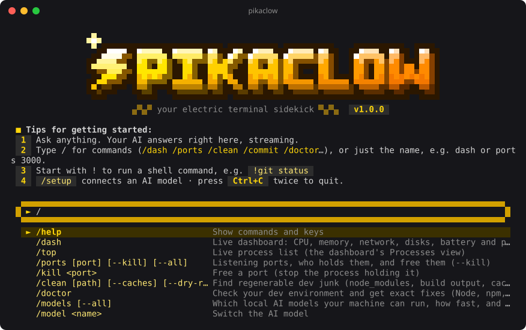

<p align="center">
  
</p>

<h1 align="center">PikaClow ⚡</h1>

<p align="center">
  <b>Trợ thủ tia chớp cho terminal của bạn.</b><br>
  Bảng theo dõi hệ thống nhẹ nhàng, tìm và giải phóng cổng mạng, dọn rác dev mà không bao giờ đụng vào mã nguồn,
  kiểm tra môi trường dev, cùng trợ lý AI chạy local giúp viết commit message, biến câu nói thành lệnh shell và giải
  thích lỗi. Riêng tư mặc định, chạy offline được, ưu tiên Windows.
</p>

<p align="center"><a href="README.md">English</a></p>

---

## Cài đặt

```bash
npm install -g pikaclow
pikaclow init      # một lần: để PikaClow bắt lệnh bị lỗi (Alt+Z)
pikaclow
```

Cần Node.js 20 trở lên. Tính năng AI là tuỳ chọn: dùng [Ollama](https://ollama.com) ngay trên máy bạn, hoặc bất kỳ API
tương thích OpenAI nào (LM Studio, OpenRouter, Groq, Gemini, OpenAI…). Chạy `pikaclow setup` để kết nối.

Giao diện tự nhận tiếng Việt theo hệ thống; hoặc dùng `pikaclow --lang vi`, hay gõ `/lang vi` trong chế độ tương tác
(sẽ được lưu lại).

## Điểm khác biệt

- **Lệnh lỗi? Bấm Alt+Z.** Sau khi chạy `pikaclow init`, PowerShell, bash, zsh và fish sẽ nhớ lệnh gần nhất bị lỗi
  và hiện một dòng gợi ý ngay bên dưới. Bấm Alt+Z (hoặc `pikaclow fix`) để chạy lại, đọc thông báo lỗi thật và
  giải thích cách sửa; nếu nguyên nhân là cổng bị chiếm, nó giải phóng cổng rồi chạy lại. Hook chỉ là vài dòng
  shell: không mở tiến trình Node mỗi lần hiện dấu nhắc, không chạy nền, và lệnh nguy hiểm không bao giờ bị chạy
  lại khi chưa hỏi bạn.
- **`pikaclow dev` chạy dự án trong một lệnh.** Tự chọn đúng trình quản lý gói, cài dependencies nếu thiếu, và khi
  cổng 5173 đang bị *Vite của dự án khác* giữ, nó nói rõ và đề nghị dừng tiến trình đó hoặc chuyển sang 5174. Nếu
  server bị lỗi, nó đề nghị giải thích nguyên nhân.
- **Pixel art toàn bộ.** Logo, tiêu đề, khung, thanh đo, menu, nút bấm và thanh trạng thái đều được vẽ bằng pixel
  art sắc nét (ký tự nửa khối), tông vàng Pikachu; có chế độ dự phòng cho console đời cũ, nền sáng và ASCII.
- **Màn hình tương tác.** Gõ `pikaclow` không kèm lệnh: ô nhập kiểu Gemini, menu lệnh `/`, lịch sử, `!lệnh` để chạy
  shell, và chat AI trả lời trực tiếp, biết hệ điều hành, shell, thư mục và nhánh git của bạn.
- **Biết ai đang giữ cổng.** `pikaclow ports 3000` cho biết đó là *Vite của dự án `~/work/shop`* chứ không chỉ là
  `node.exe`, cảnh báo nếu máy khác cùng Wi-Fi truy cập được, gợi ý cổng trống kế tiếp, và giải phóng bằng `--kill`.
- **Giải thích lỗi rồi sửa luôn.** `pikaclow explain -- npm run dev` chạy lệnh của bạn; nếu lỗi `EADDRINUSE`, nó đề
  nghị dừng tiến trình đang giữ cổng và chạy lại. Nhận diện offline hơn 25 lỗi phổ biến (PowerShell chặn script,
  thiếu module, hết bộ nhớ heap, ERESOLVE, SSH key…), sau đó AI phân tích sâu hơn.
- **Lệnh shell từ câu nói, được kiểm tra bằng code.** `pikaclow sh "10 file nặng nhất ở đây"` viết lệnh cho *đúng*
  shell bạn đang dùng. Bộ kiểm tra có sẵn (không phải AI) đánh dấu phần nguy hiểm (`rm -rf`, `git reset --hard`,
  `curl | sh`, `setx PATH`…) và bắt bạn gõ `yes` trước khi chạy.
- **Dọn rác không thể xoá nhầm mã nguồn.** Chỉ đề xuất thư mục tạo lại được (`node_modules`, `.next`, `target`,
  `__pycache__`, `bin/obj`…) và chỉ khi nằm cạnh tệp đánh dấu dự án (`package.json`, `Cargo.toml`, `*.csproj`…).
  `dist`/`build`/`out` chỉ được chọn sẵn khi git xác nhận chúng đã được ignore.
- **Gợi ý model trung thực.** `pikaclow models` đo băng thông bộ nhớ và ước lượng **token/giây** cho từng model, nên
  laptop sẽ được gợi ý model chạy mượt thật sự, không phải model to nhất vừa đủ RAM.
- **Commit message cả khi offline.** `pikaclow commit` dùng AI khi có, và bộ sinh Conventional Commit dựa trên tệp
  thay đổi khi không có. Tiếng Anh hoặc tiếng Việt.
- **Nhẹ máy.** Trên Windows, dashboard dùng chung một tiến trình PowerShell thay vì mở tiến trình mới mỗi lần đo, không
  bao giờ đo chồng lên nhau, và tự hiển thị CPU/RAM của chính nó ở góc dưới (thường khoảng 1–2%).

## Các lệnh

| Lệnh | Chức năng |
| --- | --- |
| `pikaclow` | Chế độ tương tác (ô nhập, menu `/`, `!shell`, chat AI) |
| `pikaclow init [shell]` | Tích hợp shell: nhớ lệnh bị lỗi, Alt+Z để giải thích · `--uninstall` · `--print` |
| `pikaclow fix` | Chạy lại và giải thích lệnh vừa bị lỗi · `--yes` · `--no-ai` |
| `pikaclow dev [script]` | Chạy dev server; tự xử lý cổng bị chiếm, cài dependencies còn thiếu · `--port` |
| `pikaclow dash` · `top` | Dashboard: CPU, RAM, mạng, ổ đĩa, pin, tiến trình (sắp xếp, gộp nhóm, lọc, dừng) |
| `pikaclow ports [cổng]` | Cổng đang mở, nhận diện ứng dụng/dự án · `--kill` · `--pick` · `--all` · `--json` |
| `pikaclow clean [thư-mục]` | Tìm và xoá thư mục dev tạo lại được · `--dry-run` · `--caches` cho cache npm/pnpm/yarn/pip |
| `pikaclow doctor` | Kiểm tra Node, npm, git, PATH, ổ đĩa, execution policy, long paths, AI… kèm lệnh sửa |
| `pikaclow ask "…"` | Hỏi AI; pipe văn bản vào làm ngữ cảnh: `cat log.txt \| pikaclow ask "vì sao?"` |
| `pikaclow sh "…"` | Câu nói → lệnh shell, kiểm tra rủi ro, rồi chạy / sao chép / sửa |
| `pikaclow explain` | `explain -- <lệnh>`, `lệnh 2>&1 \| pikaclow explain`, hoặc `explain "nội dung lỗi"` |
| `pikaclow commit` | Commit message cho thay đổi đã stage · `--all` · `--yes` · `--dry-run` · `--msg-lang vi` |
| `pikaclow models` | Model nào chạy tốt trên máy, nhanh cỡ nào, tải và đổi model · `--pull <model>` |
| `pikaclow setup` | Ngôn ngữ, nhà cung cấp AI, model, ngôn ngữ commit |

Lệnh nào cũng có `--help`. Cờ chung: `--lang en|vi`, `--ascii`, `--no-color`.

## Thiết lập AI

**Chạy local, riêng tư (khuyên dùng):** cài [Ollama](https://ollama.com/download) (`winget install Ollama.Ollama`
trên Windows), sau đó chạy `pikaclow models`, chọn model được gợi ý. PikaClow sẽ tải về và đặt làm mặc định.

**API tương thích OpenAI:** `pikaclow setup` → *API tương thích OpenAI* → chọn LM Studio, OpenRouter, Groq, Gemini,
OpenAI, DeepSeek hoặc URL tuỳ ý. API key có thể đọc từ biến môi trường (khuyên dùng) hoặc lưu trong tệp cấu hình.

## Cấu hình

Cài đặt nằm ở `~/.pikaclow/config.json`. Một số biến môi trường hữu ích:

| Biến | Tác dụng |
| --- | --- |
| `PIKACLOW_LANG` | `en` hoặc `vi` |
| `PIKACLOW_THEME` | `light` cho terminal nền sáng |
| `PIKACLOW_ASCII=1` | Chỉ dùng ký tự ASCII (console đời cũ) |
| `PIKACLOW_NO_ANIM=1` | Tắt hiệu ứng logo |
| `NO_COLOR=1` | Tắt màu |
| `PIKACLOW_DEBUG=1` | Hiện chi tiết lỗi |
| `PIKACLOW_HINT=0` | Giữ tích hợp shell nhưng ẩn dòng gợi ý sau khi lệnh lỗi |
| `PIKACLOW_NO_UPDATE_CHECK=1` | Không kiểm tra phiên bản mới trên npm |

## An toàn

- `clean` xoá vĩnh viễn, nhưng chỉ những thư mục có thể tạo lại, và luôn hỏi trước (trừ khi dùng `--yes`).
- `ports --kill` từ chối dừng tiến trình hệ điều hành và luôn hỏi trước khi dừng.
- `sh` không bao giờ chạy lệnh khi chưa được bạn đồng ý; lệnh nguy hiểm phải gõ `yes`.
- `fix` chỉ chạy lại khi bạn chọn; lệnh bị đánh dấu nguy hiểm không bao giờ tự chạy lại.
- `init` chỉ thêm một khối có đánh dấu vào profile của shell, và `init --uninstall` gỡ đúng khối đó.
- Không có dữ liệu nào bị gửi đi trừ khi bạn cấu hình API AI từ xa. Với Ollama, mọi thứ ở lại trên máy bạn.

## Phát triển

```bash
npm install
npm run dev -- ports          # chạy từ mã nguồn
npm test                      # unit test
npm run test:e2e              # chạy CLI thật trong terminal giả lập
npm run build && npm link     # thử lệnh "pikaclow" đã build
npm run screenshots           # tạo lại ảnh docs/*.svg
```

## Giấy phép

MIT
